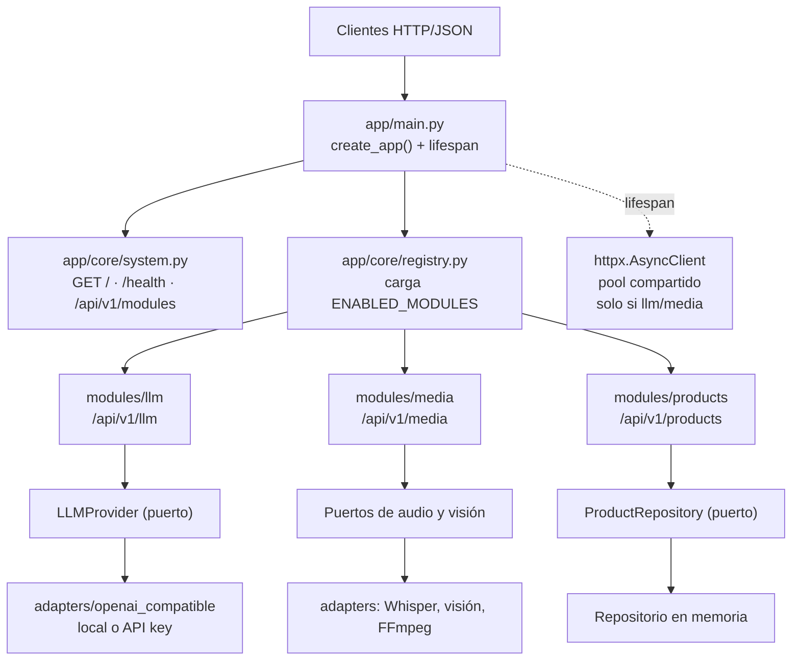

# FastAPI AI Integration Basic

API REST reutilizable con FastAPI, orientada a integraciones con aplicaciones web y móviles mediante HTTP/JSON, servicios Java/Python, proyectos de análisis de datos, modelos de Machine Learning y proveedores de IA generativa.

> **Estado:** arquitectura modular con módulos opcionales (llm, media, products). La API incluye generación de texto, transcripción de audio, análisis de video y CRUD demostrativo. El almacenamiento en memoria es didáctico; la API no está lista para producción hasta completar la revisión de seguridad y operación.

## Objetivo

Construir una API modular y documentada que pueda integrarse en distintos proyectos mediante HTTP/JSON, manteniendo desacopladas la capa HTTP, la lógica de negocio, la persistencia y las integraciones externas.

## Alcance de la primera versión

- Aplicación REST basada en FastAPI, versionada bajo `/api/v1` y documentación interactiva OpenAPI/Swagger.
- Contratos de entrada y salida definidos mediante Pydantic.
- Recurso CRUD demostrativo para aprender y validar los contratos.
- Capa de repositorio que permite cambiar el almacenamiento, sin acoplar la lógica de negocio a una tecnología concreta.
- **Arquitectura modular**: cada capacidad (llm, media, products) es un módulo autocontenido con su propio router, servicio, puertos, adaptadores, esquemas y manejadores de error.
- Integración LLM con adaptador HTTPX asíncrono que usa API key del lado servidor.
- Transcripción de audio mediante carga multipart y un modelo configurado por separado.
- Análisis de video mediante muestreo de fotogramas y transcripción opcional de la pista de audio.
- Contrato de respuesta LLM propio, independiente del JSON original del proveedor.
- Configuración del proveedor mediante variables de entorno.
- Fábrica de proveedores LLM seleccionable por `LLM_PROVIDER` (extensible sin tocar código existente).
- Módulos activables/desactivables por `ENABLED_MODULES`.
- Pruebas automatizadas que simulan el proveedor; la suite no necesita una clave real ni incurre en costes.
- Documentación dirigida a desarrolladores y agentes de programación.

La arquitectura es un **monolito modular**: comparte un proceso de despliegue en esta fase, pero separa responsabilidades en módulos independientes para que los adaptadores se puedan sustituir sin reescribir endpoints.


## Arquitectura

Monolito modular: un **núcleo mínimo** (`app/core/`) y **módulos opcionales**
(`app/modules/<nombre>/`) que se activan con la variable `ENABLED_MODULES`.
Solo se importan y se montan los módulos habilitados.



Cada módulo exporta un `ModuleSpec` en `manifest.py` con:
- `router`: APIRouter sin prefijo (el registry añade `/api/v1/<name>`)
- `register`: manejadores de error opcionales
- `requires`: dependencias entre módulos (media → llm)
- `lifespan`: recursos de larga duración opcionales


## Casos de uso previstos

- Exponer resultados de modelos de Machine Learning por HTTP/JSON.
- Integrar una aplicación React, Angular u otra interfaz web.
- Consumir la API desde una aplicación Java/Spring Boot, Python o móvil.
- Añadir servicios de IA generativa a través de un proveedor configurable.
- Reutilizar la estructura en proyectos de análisis de datos y automatización.

## Tecnologías y entorno

- Python 3.13.
- FastAPI `0.161.1`, instalado con el extra `standard` para disponer del CLI de desarrollo.
- Pydantic 2 (instalado como dependencia de FastAPI).
- Desarrollo local en Windows con PowerShell y VS Code o IDE equivalente.
- `pyproject.toml` registra el punto de entrada `app.main:app` para el CLI y las herramientas compatibles.

### Dependencias

| Origen | Contenido | Notas |
|--------|-----------|-------|
| `pyproject.toml` | Fuente única. `fastapi[standard]==0.161.1`, `httpx>=0.28,<1.0`, `pydantic-settings>=2.10,<3.0`, `python-dotenv>=1.0,<2.0` | `requires-python = ">=3.13"` (V8: `pip install -e .` falla en 3.11/3.12) |
| `requirements.txt` | `-e .[media,dev]` | Sin pines `==`; deriva de `pyproject.toml` |
| `constraints.txt` | 64 pines generados con `pip freeze` (Windows + Python 3.13) | Incluye `colorama`, omite `uvloop`; no es lock multiplataforma (V7) |
| Extra `media` | `imageio-ffmpeg>=0.6.0,<1.0`, `python-multipart>=0.0.20,<1.0` | Solo necesario para análisis de video/audio (V9) |
| Extra `dev` | `pytest>=8.0` | Para ejecutar la suite de pruebas |

## Inicio rápido — Windows / PowerShell

Desde la raíz del repositorio:

- py -3.13 -m venv .venv
- .\\.venv\Scripts\Activate.ps1
- python -m pip install --upgrade pip
- python -m pip install -r requirements.txt
- fastapi dev

Si ya existe `.venv`, actívalo y omite el comando de creación.
Guía detallada: [`docs/setup.md`](docs/setup.md).

Direcciones locales:

- `GET /` — estado básico.
- `GET /health` — health check.
- `GET /api/v1/modules` — lista módulos activos.
- `GET /docs` — Swagger UI.
- `GET /redoc` — ReDoc.
- `GET /openapi.json` — contrato OpenAPI.

Ejecutar pruebas desde la raíz del repositorio:

```powershell
python -m unittest discover -s tests -v
```

Con el servidor activo, abre:

- Inicio: http://127.0.0.1:8000/
- Swagger UI: http://127.0.0.1:8000/docs
- ReDoc: http://127.0.0.1:8000/redoc
- OpenAPI JSON: http://127.0.0.1:8000/openapi.json

## Endpoints

| Método | Ruta | Éxito | Descripción |
|---|---|---:|---|
| `GET` | `/` | `200` | Estado básico de la API. |
| `GET` | `/health` | `200` | Health check. |
| `GET` | `/api/v1/modules` | `200` | Lista módulos activos con versión y descripción. |
| `POST` | `/api/v1/products` | `201` | Crear un producto. |
| `GET` | `/api/v1/products` | `200` | Listar productos (skip, limit, include_desc). |
| `GET` | `/api/v1/products/{product_id}` | `200` | Consultar producto por ID. |
| `PUT` | `/api/v1/products/{product_id}` | `200` | Reemplazar campos editables y conservar el ID. |
| `DELETE` | `/api/v1/products/{product_id}` | `204` | Eliminar producto sin cuerpo de respuesta. |
| `POST` | `/api/v1/llm/ask` | `200` | Solicitar una generación de texto al proveedor configurado. |
| `POST` | `/api/v1/media/transcriptions` | `200` | Transcribir un archivo de audio subido. |
| `POST` | `/api/v1/media/videos/analyze` | `200` | Analizar fotogramas y, si se solicita/configura, la transcripción de audio de un video subido. |

Las rutas versionadas se montan dinámicamente por el registry. Cada módulo registra su router bajo `/api/v1/<module>`.

Un ID de producto inexistente en GET/PUT/DELETE devuelve `404`:

```json
{
  "detail": "Product with id 999999 not found"
}
```

Las entradas que no cumplen tipos o restricciones siguen devolviendo `422` con los detalles estructurados de FastAPI/Pydantic. El esquema `ErrorResponse` corresponde al error de recurso inexistente; no representa el formato de validación `422`.

#### ¿Por qué un POST repetido genera otro ID?

Cada solicitud válida `POST /api/v1/products` crea un recurso nuevo. Si se envía dos o tres veces el mismo JSON, se obtienen IDs distintos; es el contrato actual de creación, no un error del contador. El API no deduplica por igualdad de campos, porque esos campos no identifican universalmente la identidad de un producto. Consulta `docs/create-and-idempotency-semantics.md` para diferenciar unicidad de negocio e idempotencia de reintentos.

## Módulos y directorios clave

```
app/
├── main.py                 # create_app(enabled=...) + lifespan HTTP client
├── core/                   # Configuración y núcleo transversal
│   ├── config.py           # Settings + enabled_modules_list + LLM_PROVIDER
│   ├── module.py           # ModuleSpec dataclass
│   ├── registry.py         # resolve() + install_modules()
│   ├── system.py           # Router: GET /, /health, /api/v1/modules
│   └── schemas.py          # ErrorResponse compartido
└── modules/
    ├── llm/                # Generación de texto
    │   ├── manifest.py     # ModuleSpec (name=llm, register=errors)
    │   ├── router.py       # POST /ask
    │   ├── service.py      # LLMService (caso de uso)
    │   ├── deps.py         # get_llm_service (inyecta proveedor)
    │   ├── errors.py       # 502/503/504 → ErrorResponse
    │   ├── ports.py        # LLMProvider protocol + errores dominio
    │   ├── schemas.py      # LLMAskRequest/Response/Usage
    │   └── adapters/
    │       ├── __init__.py # build_provider factory (LLM_PROVIDER)
    │       └── openai_compatible.py
    ├── media/              # Audio + Video
    │   ├── manifest.py     # ModuleSpec (requires=llm)
    │   ├── router.py       # POST /transcriptions, /videos/analyze
    │   ├── service.py      # Audio/Video Analysis Services
    │   ├── deps.py         # get_audio/video_service (inyectan HTTP client)
    │   ├── errors.py       # 413/415/422/502/503/504 → ErrorResponse
    │   ├── ports.py        # AudioTranscriptionProvider, VideoVisionProvider, VideoProcessor
    │   ├── schemas.py      # MediaTranscriptionResponse, VideoAnalysisResponse
    │   └── adapters/
    │       ├── __init__.py # exports
    │       ├── ffmpeg_video_processor.py
    │       ├── openai_audio.py
    │       └── openai_vision.py
    └── products/           # CRUD demo
        ├── manifest.py     # ModuleSpec (name=products)
        ├── router.py       # CRUD /products
        ├── service.py      # ProductService
        ├── deps.py         # get_product_service (singleton repo)
        ├── errors.py       # ProductNotFoundError → 404
        ├── repository.py   # ProductRepository protocol
        ├── in_memory_repository.py
        ├── models.py       # Product / ProductDraft
        ├── exceptions.py   # ProductNotFoundError
        └── schemas.py      # ProductCreate/Read/ListResponse
```

tests/
├── test_app_factory.py                  # 2 tests
├── test_architecture.py                 # 23 tests (AST, reglas de modularización)
├── test_audio_adapter.py                # 6 tests
├── test_audio_integration.py            # 4 tests
├── test_http_errors.py                  # 9 tests
├── test_lifespan.py                     # 12 tests (ciclo de vida, cliente HTTP compartido)
├── test_llm_api.py                      # 6 tests
├── test_llm_connection.py               # Script standalone de prueba real (0 tests en pytest)
├── test_llm_integration.py              # 6 tests
├── test_llm_provider.py                 # 9 tests
├── test_llm_service.py                  # 3 tests
├── test_media_api.py                    # 6 tests
├── test_media_endpoints.py              # 11 tests
├── test_media_providers.py              # 5 tests
├── test_media_service.py                # 7 tests
├── test_packaging.py                    # 5 tests (empaquetado)
├── test_product_api.py                  # 10 tests
├── test_product_create_semantics.py     # 3 tests
├── test_product_service.py              # 5 tests
├── test_registry.py                     # 18 tests (registry, clasificación de errores)
├── test_registry_imports.py             # 10 tests (clasificación A/B/C/D, build_provider)
├── test_video_integration.py            # 4 tests
├── test_video_processor_integration.py  # 1 test
└── test_vision_adapter.py               # 7 tests

Total: 172 tests (pytest), 0 fallos, 0 omitidos. No existe `tests/test_modularity.py`.
```

### Configurar el proveedor LLM

1. Copia `.env.example` a `.env` en la raíz.
2. Completa `LLM_API_KEY`, `LLM_BASE_URL` y `LLM_MODEL` con valores de un proveedor habilitado.
3. Conserva el archivo `.env` solo en local: `.gitignore` lo excluye.

El adaptador implementado habla el protocolo `POST {LLM_BASE_URL}/chat/completions` compatible con OpenAI Chat Completions. **No se fija un proveedor comercial concreto**: el host, la credencial y el modelo se configuran por entorno.

La fábrica en `app/modules/llm/adapters/__init__.py` permite añadir nuevos proveedores (ej. `anthropic`) creando un adaptador y una línea en `_PROVIDERS`.

Para hosts externos `LLM_BASE_URL` requiere HTTPS; se permite HTTP solo en loopback para pruebas de proveedores locales.

La API puede arrancar sin credenciales para utilizar el CRUD; la llamada LLM devuelve `503` mientras el proveedor no esté configurado correctamente.

Guía completa: [`docs/llm-integration.md`](docs/llm-integration.md).

### Configurar audio y video (multimodal)

Para transcripción de audio (Whisper), añade a `.env`:

```ini
MEDIA_TRANSCRIPTION_MODEL=whisper-large-v3
# o: MEDIA_TRANSCRIPTION_MODEL=whisper-large-v3-turbo
MEDIA_MAX_AUDIO_MB=25
```

Para análisis de video, ajusta los límites según necesidad:

```ini
MEDIA_MAX_VIDEO_MB=50
MEDIA_VIDEO_MAX_DURATION_SECONDS=120
MEDIA_VIDEO_MAX_FRAMES=8
MEDIA_VIDEO_FRAME_INTERVAL_SECONDS=5
MEDIA_PROCESSING_TIMEOUT_SECONDS=60
```

**Importante:** `MEDIA_TRANSCRIPTION_MODEL` es independiente de `LLM_MODEL`. Whisper usa el endpoint `/audio/transcriptions`, no `/chat/completions`. Usa `POST /api/v1/media/transcriptions` para audio y `POST /api/v1/media/videos/analyze` para video.

Guía completa: [`docs/multimodal-media.md`](docs/multimodal-media.md).

### Módulos opcionales

La variable `ENABLED_MODULES` (en `.env` o entorno) controla qué módulos se cargan:

```bash
# Solo CRUD de productos
ENABLED_MODULES=products

# Solo LLM
ENABLED_MODULES=llm

# LLM + Media (sin productos)
ENABLED_MODULES=llm,media

# Todos (por defecto)
ENABLED_MODULES=llm,media,products
```

En pruebas, usa `create_app(enabled=["products"])` para aislar módulos.

## Ejecutar y abrir la documentación

```powershell
fastapi dev
```

- Inicio: <http://127.0.0.1:8000/>
- Swagger UI: <http://127.0.0.1:8000/docs>
- ReDoc: <http://127.0.0.1:8000/redoc>
- OpenAPI JSON: <http://127.0.0.1:8000/openapi.json>

### Ejemplo de solicitud LLM

`POST /api/v1/llm/ask`

```json
{
  "prompt": "Resume qué problema resuelve una API REST.",
  "system_prompt": "Responde en español y de forma concisa."
}
```

Respuesta pública normalizada (el texto es ilustrativo):

```json
{
  "response": "Una API REST permite ...",
  "provider": "openai_compatible",
  "model": "modelo-configurado",
  "usage": {
    "input_tokens": 18,
    "output_tokens": 42
  }
}
```

Errores LLM conocidos: `422` para solicitud inválida, `502` para error o respuesta incompatible del proveedor, `503` para configuración ausente/límite temporal del proveedor y `504` para timeout. No se devuelve el cuerpo original de error del proveedor.

## Pruebas

Desde la raíz del repositorio, con el entorno virtual activado:

```powershell
python -m pytest -q
```

Resultado real medido en esta sesión (Python 3.13.9, `fix/fase1-cierre` HEAD `16dab3b`): **172 passed, 0 failed, 0 skipped** en 27.99s.

Recuento por comando de recolección:

```powershell
python -m pytest --collect-only -q
```
→ `172 tests collected`

También es compatible con `unittest`:

```powershell
python -m unittest discover -s tests -v
```

**Nota importante (V4):** la suite no es hermética. Sin `LLM_API_KEY`, `LLM_BASE_URL` y `LLM_MODEL` configurados, `test_lifespan.py::LifespanTests::test_llm_ask_with_mock_transport_returns_200` falla (recibe `503`, espera `200`) porque `get_settings()` lee el entorno. Pendiente: hacer la suite hermética para que pase sin credenciales.

Secciones cubiertas:

- Contratos Pydantic y schemas (unidad).
- Servicio LLM con adaptador simulado (unidad).
- Adaptador LLM y contratos HTTP (integración).
- Router `/api/v1/products` y endpoints (integración).
- **Modularidad**: solo módulos habilitados se montan, módulo desconocido falla rápido, `/api/v1/modules` lista activos (ver `tests/test_registry.py`, `tests/test_architecture.py`).
- **Integración LLM**: `tests/test_llm_integration.py` (6 tests con servicio simulado).
- **Integración Audio**: `tests/test_audio_integration.py` (4 tests con servicio simulado).
- **Integración Video**: `tests/test_video_integration.py` (4 tests con servicio simulado).
- **Registry**: `tests/test_registry.py` (18 tests incluyendo D-1 y D-2).
- **Arquitectura**: `tests/test_architecture.py` (23 tests AST).
- **Lifespan**: `tests/test_lifespan.py` (12 tests).
- **Clasificación de imports**: `tests/test_registry_imports.py` (10 tests).
- **Empaquetado**: `tests/test_packaging.py` (5 tests).

Las pruebas del adaptador usan `httpx.MockTransport`; no realizan llamadas a Internet. Para comprobar que una clave real y el modelo elegido funcionan, realiza después una prueba manual y controlada desde Swagger, teniendo en cuenta el consumo que facture el proveedor.

**Verificación real en servidor:** `POST /api/v1/llm/ask` → **200** con respuesta real de Groq (`"¡Hola! ¿Cómo estás? ¿En qué puedo ayudarte hoy?"`).

## Limitaciones y seguridad

- Los `POST` de productos crean un recurso nuevo cada vez, aunque los campos sean idénticos; no existe deduplicación por igualdad de campos.
- El CRUD usa memoria: los productos desaparecen al reiniciar el proceso y no se comparten entre instancias.
- El LLM implementado es de una sola interacción; no persiste historial y no incluye streaming.
- No se hacen reintentos automáticos de generación, porque repetir un POST tras un timeout podría duplicar consumo.
- La API key del proveedor permanece en el backend. No se acepta una API key en el JSON de los clientes.
- La clave del proveedor no autentica a los consumidores de esta API. Autenticación, autorización, rate limiting y cuotas son tareas distintas que deberán abordarse antes de exponer el servicio.
- No hay todavía persistencia durable, despliegue, CI ni observabilidad completa.

## Documentación del proyecto

- [Alcance y requisitos del proyecto](docs/project-scope.md)
- [Arquitectura actual](docs/architecture.md)
- [Criterios de aceptación](docs/acceptance-criteria.md)
- [Instalación y primer endpoint](docs/setup.md)
- [Rutas y parámetros](docs/path-and-query-parameters.md)
- [Validación con Pydantic](docs/pydantic-validation.md)
- [CRUD](docs/crud.md)
- [Manejo de errores HTTP y capas](docs/http-errors.md)
- [Modularización con APIRouter](docs/api-routing.md)
- [Creación repetida e idempotencia](docs/create-and-idempotency-semantics.md)
- [Manifiesto de archivos de sección 6](docs/section-06-manifest.md)
- [Manifiesto de archivos de sección 7](docs/section-07-manifest.md)
- [Manifiesto de archivos de sección 8](docs/section-08-manifest.md)
- [Decisión de arquitectura (ADR-001)](docs/decisions/ADR-001-architecture.md)
- [Integración LLM](docs/llm-integration.md)
- [Audio y video (multimodal)](docs/multimodal-media.md)
- [Cierre de la Fase 1](docs/phase1-closure.md)
- [Reglas para agentes de programación](AGENTS.md)

## Roadmap por secciones

| Sección | Tema                                               | Estado                           |
| -------- | -------------------------------------------------- | -------------------------------- |
| 1        | Introducción, alcance y arquitectura              | Completada                       |
| 2        | Entorno de desarrollo y primer endpoint            | Completada                       |
| 3        | Rutas y parámetros                                | Completada                       |
| 4        | Validación con Pydantic                           | Completada                       |
| 5        | CRUD                                               | Completada                       |
| 6        | Manejo de errores HTTP y separación de capas      | Completada                       |
| 7        | Modularización con `APIRouter`                    | Completada                       |
| 8        | Integración con proveedor LLM mediante API key    | Completada                       |
| 9 (Fase 1) | Arquitectura modular con registry y módulos opcionales | Implementada; cierre en verificación            |
|          | - Registry con carga dinámica e importlib          | ✅ Completado                    |
|          | - ModuleSpec con lifespan y requires               | ✅ Completado                    |
|          | - httpx.AsyncClient en lifespan (llm/media)        | ✅ Completado                    |
|          | - Tests de integración (LLM, audio, video)         | ✅ Completado                    |
|          | - Pendiente: suite hermética sin `LLM_*`           | ⏳ Cierre en verificación        |
|          | - Pendiente: CI (lint, typecheck, tests, build)    | ⏳ Fase 2                        |
| 10 (Fase 2) | Auth con API keys + rate limiting + errores unificados + CI | Pendiente           |

## Flujo de trabajo

1. Implementar únicamente la sección activa.
2. Ejecutar los comandos de validación en el equipo local.
3. Revisar con `git status`, `git diff --check` y `git diff`.
4. Actualizar la documentación para reflejar los resultados reales.
5. Crear manualmente commits acotados y subirlos a GitHub.
6. Avanzar a la siguiente sección después de confirmar el resultado.

## Seguridad y limitaciones

No subir `.venv`, `.env`, tokens, API keys u otras credenciales. La clave del proveedor de IA deberá permanecer en el backend; no será enviada al navegador ni incluida en el control de versiones. La autenticación de consumidores de esta API será una responsabilidad independiente de la credencial del proveedor LLM.

No presentar como lista para producción hasta verificar autenticación, persistencia, límites de consumo, observabilidad, pruebas, despliegue y operación.

## Decisiones iniciales

- Python 3.13 como versión objetivo.
- FastAPI para la capa HTTP.
- Pydantic para contratos y validación de datos.
- HTTPX para llamadas HTTP salientes asíncronas cuando corresponda.
- Arquitectura modular dentro de una sola aplicación; no empezaremos con microservicios.
- Proveedor LLM seleccionable por configuración; los routers y servicios no dependen directamente del SDK de un proveedor.
- Desarrollo local en Windows con VS Code o un IDE equivalente.
- Cambios organizados por sección, con validación local y commits manuales.

## Referencias oficiales

- [FastAPI — Primeros pasos](https://fastapi.tiangolo.com/tutorial/first-steps/)
- [FastAPI — Entornos virtuales](https://fastapi.tiangolo.com/virtual-environments/)
- [FastAPI en PyPI](https://pypi.org/project/fastapi/)
- [FastAPI es increíble! Apréndelo ahora! gratis!](https://www.youtube.com/watch?v=WrnFtgGLO38)
- [FastAPI — Tutorial](https://fastapi.tiangolo.com/tutorial/)
- [Python 3.13 — Entornos virtuales](https://docs.python.org/es/3.13/library/venv.html)
- [HTTPX — Soporte asíncrono](https://www.python-httpx.org/async/)