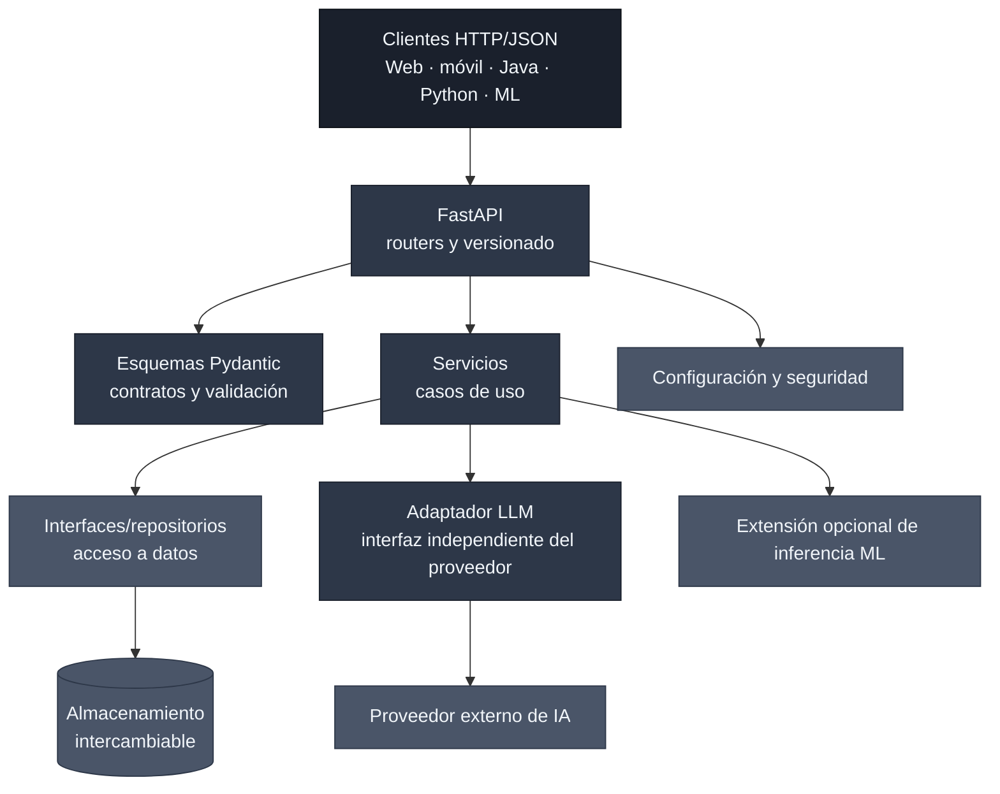
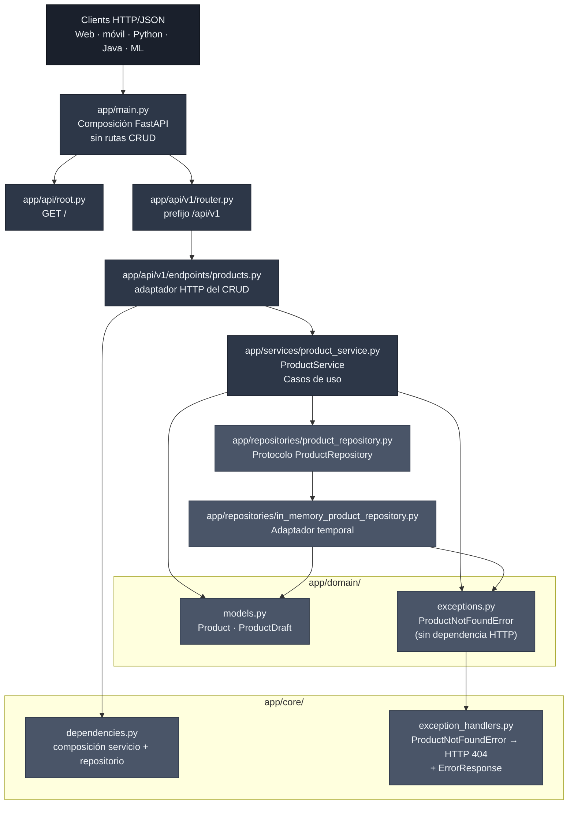

# Arquitectura evolutiva

## Objetivo

Construir una API modular y documentada que se pueda integrar mediante HTTP/JSON en aplicaciones web, móviles, servicios Python/Java, proyectos de análisis de datos, Machine Learning e IA, manteniendo separadas la capa HTTP, la lógica de negocio, la persistencia y las integraciones externas.

## 1. Estilo arquitectónico

La primera versión será un **monolito modular**: una sola aplicación desplegable, organizada en módulos con responsabilidades claras. No se dividirá prematuramente en microservicios.

El objetivo es que la API pueda crecer sin acoplar sus rutas HTTP a la lógica de negocio, al mecanismo de persistencia ni al proveedor de IA.

### Estructura actual

```text
app/
├── main.py                           # compone FastAPI y registra routers
├── api/
│   ├── root.py                       # GET /
│   └── v1/
│       ├── router.py                 # prefijo /api/v1 y agregación de routers
│       └── endpoints/products.py     # adaptador HTTP del CRUD
├── core/
│   ├── dependencies.py               # composición de servicio/repositorio
│   └── exception_handlers.py         # dominio -> respuesta HTTP
├── domain/
│   ├── models.py                     # Product y ProductDraft
│   └── exceptions.py                 # errores de dominio
├── schemas/
│   ├── product.py                   # contratos Pydantic del recurso
│   └── errors.py                    # contrato de errores HTTP
├── services/product_service.py      # casos de uso CRUD
└── repositories/
    ├── product_repository.py        # protocolo de persistencia
    └── in_memory_product_repository.py
```


## 2. Vista de alto nivel



Esta figura es conceptual; no representa módulos ya implementados.


**Arquitectura implementada (sección 7):**



### Responsabilidades y dirección de dependencias

| Capa | Responsabilidad | No debe depender de |
|---|---|---|
| `main.py` | Crear la aplicación, registrar excepciones e incluir routers | Lógica CRUD concreta |
| `app/api/` | Routers HTTP (root + v1 + endpoints). Traduce HTTP/JSON a llamadas de servicio y resultados a respuestas | Implementación directa de almacenamiento |
| `schemas/` | Validar solicitudes y definir contratos públicos | Servicio y persistencia |
| `services/` | Coordinar casos de uso y reglas de aplicación | FastAPI, `Response` o SDK de proveedores |
| `domain/` | Modelos y excepciones centrales del dominio | FastAPI, Pydantic y tecnología de datos |
| `repositories/` | Contrato y adaptadores de persistencia | Rutas HTTP |
| `core/dependencies.py` | Elegir y entregar implementaciones a la aplicación | Reglas de negocio |

## Cómo se conectan los routers

`app/main.py` incluye `app.api.root.router` para `GET /` y
`app/api.v1.router.router` para la API versionada. El router v1 aplica `/api/v1`
y agrega el router del recurso productos, cuyo prefijo es `/products`. Esta
composición conserva los paths publicados.

- `app/api/root.py`: define `GET /` con una respuesta de estado básica.
- `app/api/v1/router.py`: router agregador con prefijo `/api/v1` que incluye
  `app/api/v1/endpoints/products.py`.
- `app/api/v1/endpoints/products.py`: contiene las operaciones CRUD HTTP
  adaptadas a `ProductService`.

Para añadir un recurso futuro, se creará otro módulo bajo
`app/api/v1/endpoints/` y se incluirá su router en `app/api/v1/router.py`. Evitar
declarar una misma ruta en más de un módulo.

## Endpoints raíz y versiones

- `GET /`: informa del propósito de la API y enlaza a `/docs`.
- `GET /api/v1/`: redirige a `/api/v1/docs` sin repetir la descripción del servicio.

## Contracts, excepciones y transformaciones

- `schemas/product.py` define los contratos de entrada y salida para el recurso producto.
- `app/domain/exceptions.py` define las excepciones de dominio (ej. `ProductNotFoundError`), que no contienen lógica HTTP.
- `app/core/exception_handlers.py` transforma excepciones de dominio en respuestas HTTP (ej. `ProductNotFoundError → 404 + ErrorResponse`).

Esta separación mantiene los dominios y servicios agnósticos a HTTP. Los endpoints
HTTP (`app/api/v1/endpoints/products.py`) no tratan excepciones de dominio directamente;
las dejan al manejador registrado en `app/main.py`.

## Persistencia, servicios y composición

- `app/services/product_service.py` implementa los casos de uso y coordina repositorio y otros adaptadores.
- `app/repositories/` contiene el protocolo `ProductRepository` y su implementación en memoria.
- `app/core/dependencies.py` une servicio y repositorio para inyección de dependencias en los endpoints.
- `app/api/v1/endpoints/products.py` adapta HTTP/JSON a `ProductService` mediante `Depends(get_product_service)`.

El servicio no conoce detalles de persistencia y el endpoint solo interactúa con el servicio, lo que facilita el intercambio de mecanismos de almacenamiento.

### Duplicados y reintentos

El CRUD didáctico no deduplica un POST por igualdad de contenido. La decisión está
documentada en `docs/create-and-idempotency-semantics.md`. La unicidad de negocio
y una futura clave de idempotencia deben aplicarse en las capas apropiadas y no
introducirse como lógica improvisada en los endpoints.

## Limitaciones actuales

El repositorio de ejemplo almacena registros yisor en memoria. Esto sirve para
pruebas locales, pero los datos se pierden al reiniciar y no se comparten entre
procesos/instancias. Una futura persistencia SQL debe implementar el protocolo
`ProductRepository`; el servicio y las rutas deberían permanecer estables.

## 3. Responsabilidades por capa

### Capa HTTP: `app/api/`

- `app/api/root.py`: define `GET /` con una respuesta de estado básica.
- `app/api/v1/router.py`: router agregador con prefijo `/api/v1` que incluye los routers de los recursos.
- `app/api/v1/endpoints/products.py`: adaptador HTTP del CRUD, traduce solicitudes y respuestas a/from `ProductService`.
- Declara rutas, métodos HTTP, parámetros y códigos de respuesta.
- Mantiene el versionado público, inicialmente `/api/v1`.
- No debe contener lógica de negocio extensa ni acceder directamente a la base de datos.

### Contratos: `schemas/`

- Define modelos de solicitud y respuesta con Pydantic.
- Expresa campos obligatorios, OPTIONALES, límites y formatos.
- Evita devolver objetos internos arbitrarios como contrato público.
- No almacena secretos ni realiza llamadas externas.

### Lógica de negocio: `services/`

- Implementa casos de uso y reglas de negocio.
- Coordina repositorios y adaptadores.
- Puede probarse sin iniciar un servidor HTTP.
- No debe depender directamente de un framework web cuando una abstracción sencilla sea suficiente.

### Persistencia: `repositories/`

- Define cómo se consulta o modifica el estado persistente.
- La implementación en memoria, si se usa para la fase didáctica, será una implementación temporal.
- El servicio no debe depender de detalles específicos de una base de datos.
- La persistencia duradera y sus migraciones quedan para una etapa posterior.

### Integraciones externas: `integrations/`

- Encapsula las llamadas HTTP o SDK a proveedores externos.
- Define una frontera estable para el proveedor LLM.
- Configura timeout y tratamiento de errores de red.
- Evita que los nombres de modelos, esquemas de SDK o formatos internos del proveedor se filtren innecesariamente al contrato público.

### Configuración y seguridad: `core/`

- Centraliza configuración a partir de variables de entorno.
- Distingue configuración local de secretos.
- Aloja dependencias comunes de seguridad cuando se implementen.
- No debe incluir claves reales en código, ejemplos ni logs.

### Extensión de Machine Learning: `ml/` (futura y opcional)

- Podrá cargar artefactos de modelos existentes y exponer inferencia.
- Mantendrá separadas las dependencias pesadas de ML de los módulos básicos de la API cuando sea viable.
- No forma parte de la implementación de la sección 1.

## 4. Flujo de una solicitud

1. Un consumidor envía una solicitud HTTP/JSON.
2. FastAPI identifica la ruta y procesa parámetros y dependencias.
3. Pydantic valida la estructura de entrada.
4. El router delega el caso de uso a un servicio.
5. El servicio usa un repositorio o adaptador externo según sea necesario.
6. El resultado se convierte a un esquema de respuesta documentado.
7. La API devuelve el código HTTP y el cuerpo definidos en el contrato.


## 5. Persistencia

`ProductService` depende del protocolo `ProductRepository`, no del `InMemoryProductRepository`. Para incorporar SQL u otro almacenamiento, se implementa el protocolo y se cambia el enlace en `app/core/dependencies.py`. No se deben introducir consultas a la base de datos directamente en los endpoints.

La implementación actual guarda datos en memoria del proceso. No es durable, no sincroniza distintas instancias y solo sirve para desarrollo y aprendizaje.

## 6. Integración HTTP/JSON

Los esquemas Pydantic forman el contrato externo. Los clientes no deberían depender de clases Python internas ni de la implementación del repositorio. Cambios en esas capas deben preservar los endpoints, los códigos HTTP y la forma de respuesta, o documentarse como una evolución incompatible.

## 7. Decisión sobre LLM

El proveedor todavía no está seleccionado. El diseño debe permitir elegirlo desde configuración, pero la selección real se pospone hasta la etapa de integración.

La clave del proveedor se mantendrá en el backend. No se enviará al navegador, a aplicaciones móviles ni a los clientes que consuman esta API. La autenticación de los consumidores de nuestra API es una responsabilidad independiente de la credencial del proveedor.

## 8. Errores y contratos

- Los errores de validación se expondrán mediante respuestas coherentes con FastAPI y su contrato OpenAPI.
- Los recursos inexistentes devolverán `404` cuando aplique.
- Los errores de autenticación y autorización se distinguirán (`401` y `403`).
- Los conflictos del estado del recurso podrán usar `409`.
- Los fallos inesperados no expondrán trazas, secretos ni detalles internos al consumidor.
- El formato común de errores se definirá durante la implementación, evitando prometer uniformidad antes de probarla.

## 9. Versionado y compatibilidad

La API pública comenzará bajo `/api/v1`. Los cambios compatibles podrán añadirse dentro de la versión actual; los cambios incompatibles exigirán una estrategia explícita de migración y una versión nueva cuando corresponda.

## 10. Decisiones aún abiertas

- Proveedor LLM y modelo inicial.
- Gestor de dependencias y formato de bloqueo.
- Almacenamiento persistente definitivo.
- Mecanismo de autenticación y política de autorización concreta.
- Estrategia de despliegue y observabilidad.
- Forma de distribuir la plantilla como repositorio plantilla o paquete Python.

No necesitamos resolver estas decisiones antes del primer commit documental. Se resolverán cuando exista contexto técnico suficiente.
